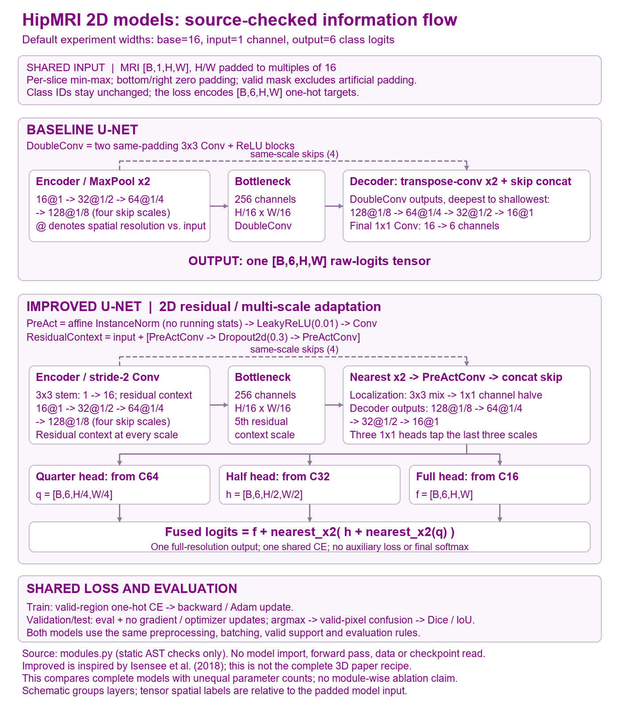
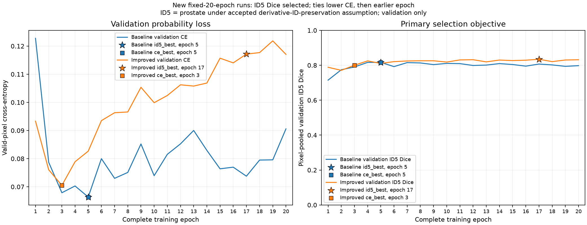
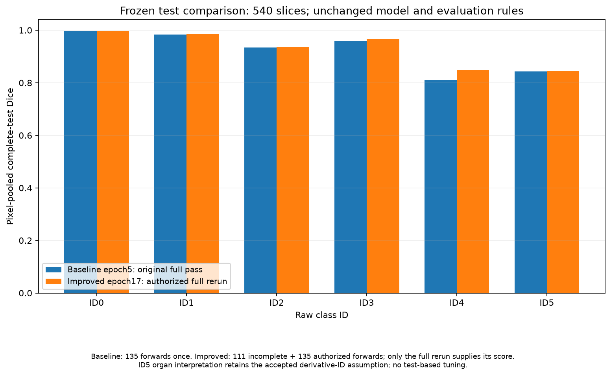
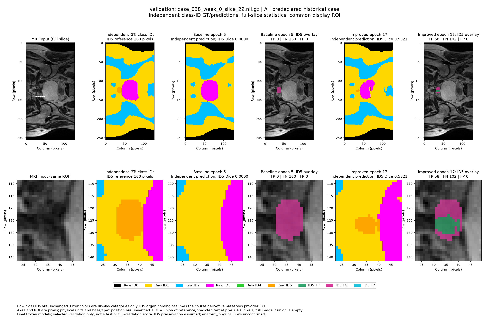
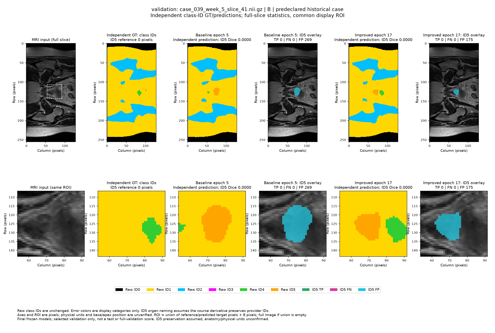
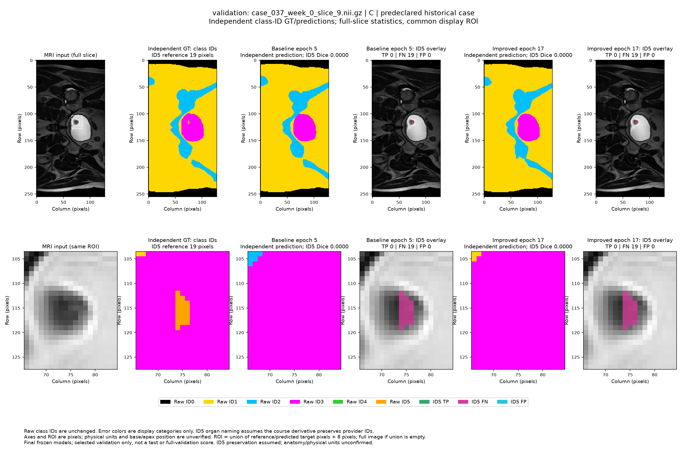
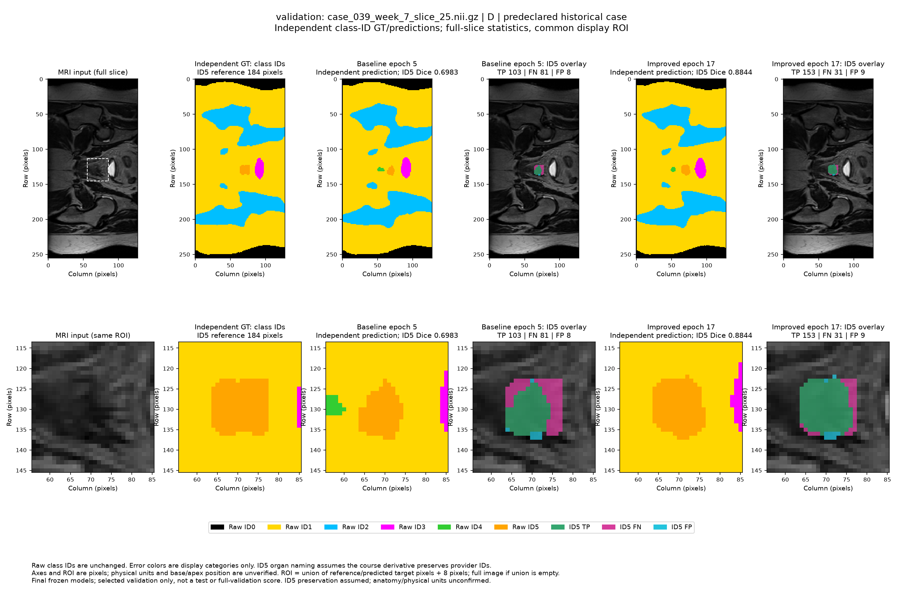
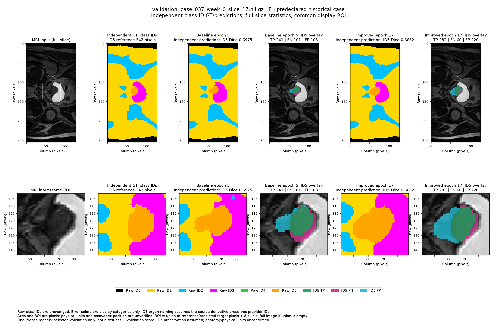

# HipMRI: 2D Improved U-Net versus U-Net

**Student:** Nuoyan Liu (s4688861). **Course:** COMP3710. **Project difficulty:** Normal. **Report updated:** 26 October 2026.

This report compares a six-class 2D Improved U-Net with a standard U-Net baseline. The final test ID5 Dice is **0.844222 versus 0.843161**, an improvement of **0.106 percentage points**, with higher false-positive and computational costs. The evidence supports a cautious prototype comparison rather than a general recommendation to upgrade.

**Tutor check-off is completed, as confirmed by the student on 26 October 2026.**

The matching PDF is generated from this README and its existing figures.

<div class="feasibility-review">

## One-page Written Feasibility Review

**Retrospective review, 26 October 2026.** This page was assembled from completed experiments with substantial Codex assistance. It is not represented as a contemporaneous midpoint proposal.

**User need and scope.** An imaging reviewer needs draft pelvic MRI contours for manual inspection. The prototype predicts six-class 2D masks and compares quality with resource cost. It does not make an autonomous clinical-use claim. The primary Normal-level model adapts Isensee et al. (2018) to 2D; the baseline follows the U-Net encoder-decoder idea. Course concepts include convolution, skip connections, residual learning, cross-entropy and validation-based model selection.

<table>
<tr><th>Testable acceptance criterion</th><th>Evidence and qualification</th></tr>
<tr><td>1. Correct MRI/mask pairing and disjoint case-proxy splits</td><td>11,460 training, 660 validation and 540 test pairs audited. True patient identities are not independently verified.</td></tr>
<tr><td>2. Preserve label IDs, use six-channel one-hot CE and exclude padding</td><td>Shared implementation and recorded checks; matching Affines have unknown spatial units.</td></tr>
<tr><td>3. Frozen ID5 test Dice at least 0.75</td><td>Baseline 0.843161; Improved 0.844222. ID5=prostate remains a disclosed derivative-label assumption.</td></tr>
<tr><td>4. Complete 20 epochs/model, batch 4, FP32 within the available 12 GiB GPU</td><td>Completed. Recorded training allocated peaks: 182.642 / 567.992 MiB, not total-device VRAM.</td></tr>
<tr><td>5. Traceable comparison, resources and five diagnostic examples</td><td>Per-class Dice/IoU, scoped timing and final epoch-5/17 validation panels are included.</td></tr>
</table>

**Preliminary evidence and budget.** A 64-sample, two-epoch smoke run preceded full runs. The shared full-training budget was 20 epochs per model. The later ID5-selection runs and frozen test, including an authorised Improved-only recovery after a logging failure, are complete. The original pre-training next experiment is documented in the preserved proposal and run plans; this retrospective page does not invent an earlier decision.

**Risks and fallback.** Label provenance, patient identity proxies, unknown physical units, one seed, three test groups and prior test exposure limit conclusions. Improved gains only 0.106 percentage points in primary Dice while increasing false positives and resource use. Keep the baseline as a low-cost reference and send difficult contours for human review. The current next step is submission/document review, with no further training or test evaluation proposed. New generalisation experiments would require a separate design and independent data.

</div>

## 1. Data, labels and preprocessing

The input is a single-channel 2D NIfTI MRI slice; the target is one mutually exclusive raw class ID per pixel. Filename pairing replaces the `case_` prefix with `seg_` while retaining exactly the same case, week and slice identifiers. Equal array shapes alone do not establish a pair.

<table>
<tr><th>Split</th><th>Paired slices</th><th>Numeric case-proxy groups</th><th>Use</th></tr>
<tr><td>Training</td><td>11,460</td><td>31</td><td>Parameter updates</td></tr>
<tr><td>Validation</td><td>660</td><td>4: cases 36-39</td><td>Checkpoint selection and diagnostics</td></tr>
<tr><td>Test</td><td>540</td><td>3: cases 40-42</td><td>Frozen final comparison</td></tr>
</table>

The case sets are pairwise disjoint. Different weeks/slices of one case must not be treated as independent patients. The filename case number is an identity proxy; no independent patient crosswalk is available. The [test manifest audit](evidence/test_manifest_audit_20261026.json) records 540 pairs of shape 256 by 128, containing 17,694,720 original pixels. These pixels are not independent subjects.

The provider's original label schema is:

<table>
<tr><th>ID</th><th>Provider class</th><th>ID</th><th>Provider class</th></tr>
<tr><td>0</td><td>Background</td><td>3</td><td>Bladder</td></tr>
<tr><td>1</td><td>Body</td><td>4</td><td>Rectum</td></tr>
<tr><td>2</td><td>Bones</td><td>5</td><td>Prostate</td></tr>
</table>

The [label schema and source record](label_schema.json) document the CSIRO mapping. Applying it to the course's derived `keras_slices_data` assumes that export preserved the original IDs. This assumption was accepted for the project but is not independently proven. Masks were not relabelled. Reported primary scores therefore refer precisely to **ID5**, interpreted as prostate under that assumption.

`dataset.py` checks matching shapes and finite 4-by-4 Affines before pixel loading, using absolute tolerance 0.00001 and relative tolerance zero. The [training/validation geometry audit](evidence/geometry_audit.json) found matching identity Affines. Exported spatial units are `unknown`: header agreement is not independent proof of anatomical registration, orientation or distances in millimetres.

Preprocessing is shared by both models:

1. Load paired arrays and preserve raw integer mask IDs.
2. Apply per-slice MRI min-max normalisation: `(x - minimum) / (maximum - minimum)`. Constant slices become zero. Masks are not intensity-normalised.
3. Pad only the bottom/right to multiples of 16; collate pads samples further to the largest shape in the batch. Most slices are 256 by 128; 60 training slices are 256 by 144. These sizes already satisfy the model's factor-16 requirement, but mixed batches still need a common shape.
4. Set added MRI pixels to zero, target pixels to -100 and their valid mask to false. Every original pixel is valid, including background and zero-intensity pixels. Preserve original dimensions for cropping predictions back without interpolation.

The dataset retains integer targets. `losses.masked_one_hot` constructs `[B,6,H,W]` targets during the loss call; padding has six zeros. Model inputs are `[B,1,H,W]`, and outputs are six raw logits per pixel. Cross-entropy is averaged over valid pixels only. The shared implementation is value/gradient equivalent to the corresponding ignore-index CE, as recorded in earlier checks. No augmentation is used in the frozen protocol.

## 2. Models and shared learning procedure

The baseline uses four MaxPool downsampling stages, double 3-by-3 convolution/ReLU blocks, transposed-convolution upsampling and same-scale encoder feature concatenation. It uses same padding and base width 16; it is not the complete original U-Net training recipe.

Improved U-Net is a **2D adaptation** of the residual, multi-scale architecture described by Isensee et al. (2018): five context scales; pre-activation InstanceNorm with affine parameters and no running statistics; LeakyReLU slope 0.01; residual context blocks; Dropout2d 0.3; stride-2 convolution downsampling; nearest-neighbour upsampling followed by convolution; encoder-decoder concatenation; and localisation blocks using 3-by-3 then 1-by-1 convolutions with channel reduction. Quarter-, half- and full-resolution classification heads are progressively upsampled and summed as logits. One shared CE supervises the final fused logits; there are no separate auxiliary losses.



The [editable architecture diagram](evidence/model_architecture_20261026.svg) follows [modules.py](modules.py). Both models use base width 16, one input channel and six classes, but have different parameter counts. This compares two complete implementations, not a capacity-matched ablation or a causal test of one component. The Improved model is not a full reproduction of the original 3D BraTS loss/augmentation/training recipe.

<table>
<tr><th>Shared condition</th><th>Fixed setting</th></tr>
<tr><td>Optimisation</td><td>Valid-region one-hot cross-entropy; Adam; learning rate 0.001; weight decay 0; seed 3710</td></tr>
<tr><td>Budget</td><td>20 complete epochs/model; batch 4; 2,865 updates/epoch; 57,300 total updates/model</td></tr>
<tr><td>Other settings</td><td>FP32; workers 0; no augmentation, AMP, scheduler or early stopping</td></tr>
<tr><td>Validation/test</td><td>eval mode, gradients disabled, no optimiser updates; lexicographic order, batch 4, no shuffle, keep last batch</td></tr>
<tr><td>Prediction</td><td>Six-class argmax; original valid region; no TTA or threshold tuning</td></tr>
</table>

The recorded environment is Python 3.13.2, NumPy 2.5.4, NiBabel 5.4.2, PyTorch 2.11.0+cu128, CUDA 12.8, cuDNN 91900 and an RTX 4070 Ti with 12 GiB. CPU threads were 1; cuDNN deterministic was true and benchmark false. Matmul TF32 was false, cuDNN TF32 true and float32 matmul precision `highest`. FP32 refers to tensor dtypes with AMP disabled, not to disabling every backend TF32 setting. Exact observations are in the [run record](evidence/id5_baseline_20261026.json) and [preflight](evidence/id5_preflight_20261026.json).

For each split, accumulate a confusion matrix across all valid pixels before calculating class Dice and IoU. For one class, `Dice = 2TP / (2TP + FP + FN)` and `IoU = TP / (TP + FP + FN)`. Foreground macro scores exclude ID0 and undefined classes with both prediction/reference empty. A class with an empty reference but positive predictions scores zero. These are pooled-pixel scores, not averages of batch Dice or equally weighted patient scores. CE is weighted by valid-pixel counts and cannot be reconstructed from hard predictions. Improved's InstanceNorm sees padded inputs, so batch composition and padding are part of the shared protocol.

## 3. Validation selection and freezing

The original full experiment selected minimum validation CE, yielding baseline epoch 5 and Improved epoch 3. Diagnostics showed that Improved's best ID5 overlap occurred later than its best CE. Before the final test, the student authorised another 20-epoch run for each model under the same settings with a common selection rule: **maximum validation ID5 Dice; then minimum CE for an exact tie; then earliest epoch**. Comparisons use unrounded values. ID5-best, CE-best and last checkpoints are saved separately; `best.pt` is the selected-metric alias.

<table>
<tr><th>Selection stage</th><th>Baseline epoch / validation ID5 Dice</th><th>Improved epoch / validation ID5 Dice</th></tr>
<tr><td>Original minimum-CE experiment</td><td>5 / 0.816567</td><td>3 / 0.800187</td></tr>
<tr><td>Final common ID5-selection experiment</td><td>5 / 0.816567</td><td>17 / 0.834394</td></tr>
<tr><td>Preserved checkpoint roles</td><td>ID5-best 5; CE-best 5; last 20</td><td>ID5-best 17; CE-best 3; last 20</td></tr>
</table>

The final validation ID5 advantage is 1.783 percentage points, while foreground macro Dice is 0.903274 versus 0.896437, favouring the baseline. The [original comparison](evidence/formal_comparison_20261026.json) and [ID5 comparison](evidence/id5_comparison_20261026.json) are both preserved. The common-history metrics and CE-best/last model and Adam states matched their earlier runs: this selection change is not a new training-algorithm gain, and repeating one seed is not an independent-seed replication.



The [frozen test recipe](evidence/frozen_test_recipe_20261026.json) binds baseline epoch 5 and Improved epoch 17, checkpoint hashes, preprocessing and scoring rules. Epochs 5/17 were selected from 20 completed epochs; training did not stop early at those epochs. Test results did not choose another epoch, architecture, threshold or learning rate.

## 4. Frozen test results

<table>
<tr><th>Complete test metric</th><th>Baseline epoch 5</th><th>Improved epoch 17</th><th>Improved minus baseline</th></tr>
<tr><td>ID5 Dice</td><td>0.843161</td><td>0.844222</td><td>+0.001060 = +0.106 percentage points</td></tr>
<tr><td>ID5 IoU</td><td>0.728850</td><td>0.730435</td><td>+0.001586</td></tr>
<tr><td>Foreground macro Dice</td><td>0.906227</td><td>0.915912</td><td>+0.009685</td></tr>
<tr><td>Foreground macro IoU</td><td>0.835422</td><td>0.850269</td><td>+0.014847</td></tr>
<tr><td>Valid-pixel CE, lower is better</td><td>0.055552</td><td>0.071634</td><td>+0.016081, worse</td></tr>
<tr><td>Pixel accuracy</td><td>0.977617</td><td>0.978941</td><td>+0.001325</td></tr>
</table>

<table>
<tr><th>Raw class ID</th><th>Baseline Dice / IoU</th><th>Improved Dice / IoU</th></tr>
<tr><td>0</td><td>0.996669 / 0.993360</td><td>0.997206 / 0.994427</td></tr>
<tr><td>1</td><td>0.983693 / 0.967909</td><td>0.984636 / 0.969737</td></tr>
<tr><td>2</td><td>0.934470 / 0.877000</td><td>0.936415 / 0.880433</td></tr>
<tr><td>3</td><td>0.959706 / 0.922534</td><td>0.965891 / 0.934031</td></tr>
<tr><td>4</td><td>0.810103 / 0.680817</td><td>0.848396 / 0.736707</td></tr>
<tr><td>5</td><td>0.843161 / 0.728850</td><td>0.844222 / 0.730435</td></tr>
</table>

All pooled class Dice scores are higher for Improved, with ID4 gaining 3.829 percentage points. This does not imply that every slice or case improves. Primary ID5 Dice increases by approximately 0.1257% relative to baseline, which is distinct from the absolute gain of 0.106 percentage points. CE is approximately 28.95% higher; a loss difference is not expressed in percentage points.

<table>
<tr><th>ID5 statistics from the saved test confusion matrices</th><th>Baseline</th><th>Improved</th></tr>
<tr><td>TP / FP / FN</td><td>48,408 / 6,382 / 11,627</td><td>53,099 / 12,660 / 6,936</td></tr>
<tr><td>Precision</td><td>0.883519</td><td>0.807479</td></tr>
<tr><td>Recall</td><td>0.806330</td><td>0.884467</td></tr>
</table>

Both references contain 60,035 ID5 pixels. Improved recovers 4,691 additional true pixels but adds 6,278 false positives, explaining the small net Dice gain. These are pixel-level descriptions, not patient diagnostic sensitivity or specificity. Each complete scoring pass covers 540 slices in 135 batches with zero updates and unchanged model state. The [complete comparison](evidence/frozen_test_comparison_20261026.json) retains full precision and source bindings.



### Test interruption, recovery and exposure

The baseline completed its original 540-slice pass. Improved produced 444 outputs over 111 batch forwards before a Windows `PermissionError` during atomic logging replacement terminated that attempt. The 111th batch had not returned to the shared scoring loop; earlier aggregate statistics were lost with the process. A valid full-split score could not be reconstructed from rounded console output or the remaining samples. The original attempt remains incomplete.

The failure arose in Codex-added persistence code. The fix used unique same-directory temporary files, flush/fsync and bounded replacement retries; model forwards were not retried by that I/O fix. The specific external cause of file denial was not established. After the repeated exposure was explained, the student explicitly authorised **Improved-only full recovery** with the same frozen epoch-17 weights and rules. It completed 540 slices; baseline was not rerun. Improved therefore had 246 batch forwards and 984 sample exposures across both attempts, including 444 repeats. Final Improved scores use only the complete authorised recovery, not reconstructed partial scores. It would be inaccurate to say both models were tested exactly once.

The [failure record](evidence/frozen_test_failure_20261026.json), [additional authorisation](evidence/frozen_test_recovery_approval_20261026.json) and [recovery record](evidence/frozen_test_recovery_20261026.json) remain available. No test-driven tuning followed.

## 5. Resource cost and timing scope

<table>
<tr><th>Measurement</th><th>Baseline</th><th>Improved</th><th>Ratio</th></tr>
<tr><td>Parameters</td><td>1,940,902</td><td>3,190,194</td><td>1.644</td></tr>
<tr><td>Training peak allocated MiB</td><td>182.642</td><td>567.992</td><td>3.110</td></tr>
<tr><td>Training peak reserved MiB</td><td>250.000</td><td>694.000</td><td>2.776</td></tr>
<tr><td>Validation peak allocated MiB</td><td>92.182</td><td>141.250</td><td>1.532</td></tr>
<tr><td>Restore-phase allocated MiB</td><td>52.998</td><td>84.844</td><td>1.601</td></tr>
<tr><td>20-epoch run wall-clock seconds</td><td>2,243.088</td><td>3,549.024</td><td>1.582</td></tr>
</table>

These values come from 42 synchronised phase records/model in the [ID5 comparison](evidence/id5_comparison_20261026.json). Phase scope includes the model, Adam/gradient/activation and allocator state specified in each record. Validation includes resident training state; restoration includes its additional model. Reserved memory includes cache. The measurements are not total-device VRAM, incremental memory or an unmeasured whole-process peak. Both models completed the available GPU budget. Wall-clock ratios are run observations rather than pure compute-speed measurements.

<table>
<tr><th>Synthetic input</th><th>Baseline median / p95 batch ms</th><th>Improved median / p95 batch ms</th><th>Median ratio</th></tr>
<tr><td>B1, 256 by 128</td><td>1.146 / 3.072</td><td>4.776 / 8.876</td><td>4.169</td></tr>
<tr><td>B1, 256 by 144</td><td>1.432 / 1.574</td><td>11.024 / 12.495</td><td>7.697</td></tr>
<tr><td>B4, 256 by 128</td><td>1.347 / 1.477</td><td>10.747 / 12.402</td><td>7.977</td></tr>
<tr><td>B4, 256 by 144</td><td>3.134 / 4.028</td><td>10.756 / 12.267</td><td>3.432</td></tr>
</table>

The [baseline profile](evidence/id5_baseline_profile_20261026.json) and [Improved profile](evidence/id5_improved_profile_20261026.json) bind the frozen checkpoints. Both use the same RTX 4070 Ti/runtime, FP32 eval inference, 10 warmups and 50 synchronised timed forwards per shape; p95 uses linear interpolation. They exclude disk I/O, weight loading, transfers, metrics and plotting, and do not read test pixels. Raw timings were independently re-aggregated. B1 represents a synthetic single-slice forward; B4 is an entire batch. Neither is full-patient/sequence end-to-end latency. This single local snapshot does not isolate all system load or provide repeat-run confidence intervals. Ratios of 3.43-7.98 do not generalise automatically to other hardware.

Complete-test elapsed times of 3.611 and 8.732 seconds are not used as a fair latency comparison because the recovered Improved run used different persistence/retry logging and runtime/cache conditions.

## 6. Five final-model validation examples

The five A-E cases and their order were fixed from the earlier diagnostic list **before** generating the final epoch-5/17 displays. The [display plan](evidence/final_validation_display_plan_20261026.json) and [execution record](evidence/final_validation_display_20261026.json) describe this later validation-only supplement. Each frozen model made five B1 forwards, ten total, in eval/inference mode, with no optimiser, backward pass, gradients or state changes. The ten unique validation MRI/mask files were loaded; no real test images were read. Independent GT and predictions come from original-size arrays, not reconstructed PNGs.

<table>
<tr><th>Case / week / slice</th><th>GT ID5 pixels</th><th>Baseline TP / FP / FN</th><th>Improved TP / FP / FN</th><th>Baseline Dice</th><th>Improved Dice</th></tr>
<tr><td>A: 038 / 0 / 29</td><td>160</td><td>0 / 0 / 160</td><td>58 / 0 / 102</td><td>0.000000</td><td>0.532110</td></tr>
<tr><td>B: 039 / 5 / 41</td><td>0</td><td>0 / 269 / 0</td><td>0 / 175 / 0</td><td>0.000000</td><td>0.000000</td></tr>
<tr><td>C: 037 / 0 / 9</td><td>19</td><td>0 / 0 / 19</td><td>0 / 0 / 19</td><td>0.000000</td><td>0.000000</td></tr>
<tr><td>D: 039 / 7 / 25</td><td>184</td><td>103 / 8 / 81</td><td>153 / 9 / 31</td><td>0.698305</td><td>0.884393</td></tr>
<tr><td>E: 037 / 0 / 17</td><td>342</td><td>241 / 108 / 101</td><td>282 / 220 / 60</td><td>0.697540</td><td>0.668246</td></tr>
</table>

Each figure shows the full slice above a shared display ROI. Columns show MRI, independent six-class GT, baseline prediction and ID5 errors, then Improved prediction and ID5 errors. Green is TP, magenta FN and cyan FP; these are error colours, not new class IDs. The ROI is the reference/prediction ID5 union plus an eight-pixel margin; all metrics use the full original valid region. These are qualitative contour/error comparisons, not an independent distance-based boundary metric. Physical units and base/apex anatomy remain unverified.

### A. Missed reference region: case 038, week 0, slice 29

Improved recovers 58 of 160 reference pixels without FP, but still misses 102. A nonzero Dice does not make the contour acceptable for autonomous use; inspect the remaining region and neighbouring slices.



### B. False positives with empty reference: case 039, week 5, slice 41

The annotation contains no ID5 pixels. Improved reduces FP from 269 to 175 but both predictions remain incorrect and score zero. An empty 2D reference does not independently establish anatomical absence.



### C. Very small reference region: case 037, week 0, slice 9

Both models miss all 19 reference pixels. This illustrates a small annotated region in pixel space; it does not establish a clinically small prostate or a verified apex/base location.



### D. Improved overlap: case 039, week 7, slice 25

Improved reduces FN from 81 to 31 while adding one FP, raising Dice from 0.698305 to 0.884393. This selected example demonstrates a local benefit, not an estimated frequency of improvement.



### E. Over-segmentation cost: case 037, week 0, slice 17

Improved reduces FN from 101 to 60 but increases FP from 108 to 220, lowering Dice. Higher recall alone is not sufficient. Review the expanded contour before accepting it.



These preselected examples are not random samples, failure rates, independent-patient statistics or a replacement for complete-split B4 scoring. In case E, the B1 baseline has 108 FP whereas the earlier B4 diagnostic has 109; checkpoint/input bytes were unchanged. Batch shape/composition and floating-point effects were not isolated, so no specific cause is claimed and the original B4 score is retained.

The [earlier selection diagnosis](evidence/selection_diagnosis_20261026.json) and linked [historical report](FINAL_REPORT.md) preserve baseline-5/Improved-3/Improved-20 examples and their fixed selection rules. Those historical figures are neither final Improved-17 predictions nor test failures. The later final-model display evidence is separate from the original 19-source report summary.

## 7. Engineering recommendation and limitations

For a resource-sensitive prototype whose primary objective is ID5 overlap, the evidence does not establish enough benefit to recommend a default upgrade: primary Dice improves by only 0.106 percentage points, parameters increase 64.37%, recorded training allocated peak rises 3.11-fold, and measured synthetic forwards are slower. Retain the baseline as the low-cost engineering reference. This recommendation does not replace the pre-test selected Improved model or retrospectively select another checkpoint.

If reducing missed ID5 pixels or improving other classes is particularly valuable, Improved's higher recall and foreground macro scores may justify consideration, but extra FP and human-review costs must be counted. No predeclared clinical minimum meaningful difference, error-cost model or economic return is available. Neither statistical significance nor clinical benefit is claimed.

Evidence is limited to one seed, one derived 2D dataset and three test case-proxy groups. There is no independent patient crosswalk, no capacity-matched/module ablation, no equally weighted patient analysis, no clinical boundary review and no physical-distance metric. Prior implementation/test results had been encountered in earlier project work; this report does not claim that the data were universally unseen. The interruption and authorised repeated test exposure are disclosed above. Further tuning would require a new design and suitable independent data, not reuse of this sealed test set as a tuning set. Fragmented predictions, empty-reference FP, small missed regions and contour expansion require human inspection.

## 8. Files, dependencies and reproduction

<table>
<tr><th>Entry</th><th>Responsibility</th></tr>
<tr><td>modules.py</td><td>PyTorch model components and factory</td></tr>
<tr><td>dataset.py</td><td>Exact pairing, group audit, normalisation, padding and collate</td></tr>
<tr><td>train.py</td><td>Training/validation, curves and checkpoint roles</td></tr>
<tr><td>predict.py</td><td>Checkpoint restoration and single-slice displays; test examples require explicit opt-in</td></tr>
<tr><td>evaluate_frozen_test.py / recover_frozen_test.py</td><td>Separate shared-metric frozen testing and authorised recovery</td></tr>
<tr><td>README.md plus helper modules</td><td>Report and required losses, metrics, selection, resource and audit helpers</td></tr>
</table>

Submit the whole project directory rather than only the five named entry files. Raw data, checkpoints, environments and complete local run outputs are intentionally excluded from Git. Obtain data through the permitted course channel and prepare weights separately. An external data root must contain `keras_slices_train`, `keras_slices_seg_train`, `keras_slices_validate`, `keras_slices_seg_validate`, `keras_slices_test` and `keras_slices_seg_test`. Pass `--data-root` explicitly on another machine; defaults depend on the original computer layout.

[requirements.txt](requirements.txt) pins direct dependencies; [the observed CUDA build](requirements-cuda-observed.txt) and [23-package runtime closure](requirements-observed-lock.txt) record the actual environment. Installation details and limitations are in [DEPENDENCIES.md](DEPENDENCIES.md). A fresh-machine installation and cross-platform numerical reproduction have not been performed. PDF generation uses a separate document environment with ReportLab 4.4.9/Pillow 12.3.0, distinct from training-environment Pillow 13.0.0; see [requirements-docs.txt](requirements-docs.txt).

From the repository root, this read-only archive command checks saved evidence, source bindings, syntax and links without importing model code or reading data/weights:

```powershell
python recognition/hipmri_2d_improved_unet/verify_submission_archive.py
```

Run the command from the repository root with Git and the Python standard library. Original run records are retained; the archive verifier checks their exact source and evidence bindings. A complete clone is needed for historical-source verification; CUDA, model dependencies, data and checkpoints are not needed. To rebuild the report separately, install the document dependencies and choose a fresh PDF destination; existing files are not overwritten.

```powershell
python recognition/hipmri_2d_improved_unet/export_readme_pdf.py --output outputs/readme_review_copy.pdf
```

The following are reproduction templates. Replace external paths and choose fresh output directories. Train a baseline by replacing `improved_unet` with `baseline_unet`. The ordinary training default selects CE; specify `id5_dice` for the final selection rule. Exact formal-plan/source bindings remain in the saved run plans; a new ordinary run is not the original frozen experiment.

```powershell
python recognition/hipmri_2d_improved_unet/train.py --data-root 'C:\course-data\keras_slices_data' --output-dir 'outputs/new_training_example' --model improved_unet --epochs 20 --batch-size 4 --base-channels 16 --num-classes 6 --lr 0.001 --seed 3710 --device cuda --selection-metric id5_dice
python recognition/hipmri_2d_improved_unet/predict.py --data-root 'C:\course-data\keras_slices_data' --checkpoint 'C:\external-checkpoints\model.pt' --split validation --filename case_038_week_0_slice_29.nii.gz --output-dir 'outputs/new_validation_example' --device cuda
```

Training saves summaries, curves, ID5-best, CE-best and last weights. Prediction saves `prediction.png`, `prediction_panels.png` and its summary. A B1 display does not replace the formal B4 score.

`predict.py --help` is safe to inspect without loading a framework, checkpoint or data. The test branch rejects execution before those imports/reads unless both `--split test` and `--allow-test-example` are supplied. That branch received 11 constructed CPU checks using temporary NIfTI/random tiny weights; **no real test example was generated**. A future real test-example forward requires a new explicit decision about test exposure. The [constructed checks](evidence/prediction_display_constructed_checks_20261026.json) and [source-evolution record](evidence/submission_source_evolution_20261026.json) distinguish the post-experiment display extension from original frozen code.

## 9. Evidence

The standard-library [report collector](collect_final_report_evidence.py) reads 19 saved JSON sources and rechecks historical confusion matrices, complete scores and raw profile timings without reading MRI/masks/weights or running a framework. Its [summary](evidence/final_report_summary_20261026.json) describes that earlier snapshot. The five later validation panels are separately bound by their display plan/record. Historic source hashes are not rewritten to describe newer documentation or display helpers.

## Artificial Intelligence Usage Disclosure

**Tools and extent.** OpenAI Codex and its helper agents substantially assisted with task-sheet/paper interpretation, source checks, data/preprocessing and model code, the shared learning/evaluation pipeline, experiment execution, selection diagnostics, resource measurement, logging failure/recovery, evidence aggregation, report writing, diagrams, PDFs and Git operations. Code and automated experiment/verification commands were executed by Codex. This is not represented as independently implemented or personally run by the student.

**Student participation.** Recorded student contributions include learning responses about filename pairing, unchanged mask IDs, normalisation, valid versus padded pixels, tensor/batch dimensions, gradients and metrics; project/protocol and label-assumption decisions; and explicit training, test and Improved-only recovery authorisations. These responses and approvals are distinct from personally executing every check, auditing all data or demonstrating complete understanding of every submitted line.

**Verification and limitations.** Codex used constructed checks, smoke/full runs, checkpoint/state comparisons, saved-matrix/timing arithmetic, source hashes, image inspection and independent read-only reviews. Their scope and failures are preserved in the logs/JSON. Later work added 11 constructed CPU display checks, ten final-model validation forwards and 12 standard-library source-evolution checks. Automated validation does not prove student understanding or satisfy an originality judgement by itself. The historical implementation/test exposure, derivative-label assumption, logging failure and separately authorised repeated test exposure are disclosed rather than removed.

**Responsibility.** The student remains responsible for reviewing, understanding and explaining the submitted code, formulae and claims, and for accurate attribution. AI assistance being permitted does not transfer that responsibility or guarantee a mark/pass.

## References

- Ronneberger, O., Fischer, P., and Brox, T. (2015). [U-Net: Convolutional Networks for Biomedical Image Segmentation](https://arxiv.org/abs/1505.04597). Baseline topology inspiration; this project's same padding, width and optimiser are implementation choices.
- Isensee, F., et al. (2018). [Brain Tumor Segmentation and Radiomics Survival Prediction: Contribution to the BRATS 2017 Challenge](https://arxiv.org/abs/1802.10508). Architecture inspiration/course Ref. [2]; adapted to 2D rather than reproduced as the complete 3D recipe.
- CSIRO Data Access Portal. [Prostate MRI collection, version 2](https://doi.org/10.25919/45t8-p065), collection 52549. The source-label verification and course-derivative assumption are recorded in `label_schema.json`; this revision does not claim a fresh supporting-file retrieval.
- COMP3710 Report task sheet, 2026 v2.5, sections 2.2 and 3-8, PDF pages 5-6 and 12-17. Local assignment specification used for the project requirements and disclosure/checklist review.
